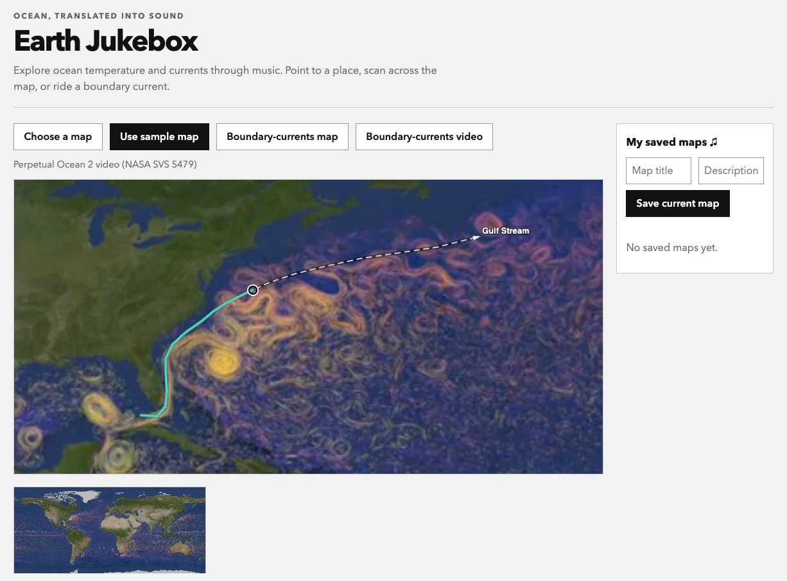

# Earth Jukebox

**Ocean, translated into sound.** NASA Space Apps Challenge 2026: *The Earth Information Jukebox*.

Earth Jukebox turns NASA ocean visualizations into music. Point at the ocean, sweep a scan across it, steer with hand gestures or your voice, or ride a western boundary current from the tropics toward the pole, and hear temperature and currents played by an orchestra.

**Live:** https://hayeonwhale.github.io/NasaSpaceX_earth-jukebox/



## How the data becomes music

| Ocean data | What you hear |
|---|---|
| Temperature, read from the map's NASA color bar | Melody pitch. In *Temperature + current* mode warm water plays brass and cold water plays piano; *Mood-based* mode uses mood presets |
| Current strength, from motion between video frames | Strings: vibrato, tremolo and intensity grow with speed |
| Steady or changing flow | Long connected notes, or short detached ones |
| East–west flow | The sound moves between your ears |
| North–south flow | The melody steps up or down |

## Ways to explore

- **Point** with the mouse, the arrow keys, a finger on a touch screen, or your hand on camera. The music follows that spot as the video plays.
- **Scan** sweeps the visible map in any direction and plays one note per strip.
- **Zoom and pan** with the wheel, the buttons, + and −, or by dragging. The music describes only what you can see, and *Where am I?* names the ocean, sea or current.
- **Hand control** (MediaPipe, runs on your device): one finger points, two zoom in, three zoom out, a four-finger swipe scans that way, five fingers after pointing say where you are, two fists stop, and one fist turns on voice control.
- **Voice control**: “go to the Gulf Stream”, “zoom in”, “scan left”, “where am I”, “trace the Kuroshio”, “boundary currents tour”, “stop”, “reset the map”.
- **Boundary currents**: ride a current or take the tour (below).
- **Saved maps**: save the current view in your browser and reopen it later.

## Western boundary currents

These are narrow, fast, warm currents pressed against the west side of every ocean basin by Earth's rotation, and they carry tropical heat toward the poles. NASA's [Perpetual Ocean 2: Western Boundary Currents](https://svs.gsfc.nasa.gov/5425/) (SVS 5425) shows them as a 3D camera flight, which cannot be read as a map. Earth Jukebox uses the same ECCO2 model run in its flat, equirectangular form ([SVS 5479](https://svs.gsfc.nasa.gov/5479/)).

- **Five currents:** Gulf Stream, Kuroshio, Agulhas, Brazil and East Australian. Their paths are approximate long-term core positions, checked against the NASA frames. They are drawn as dashed lines whose dashes drift with the flow.
- **Trace:** the view glides to the current and the cursor rides its core while the music reads the real map underneath it. The direction of the path sets the stereo position and the melody steps. Listen for the pitch falling as the water cools on its way north: the Gulf Stream reads about 21 °C off Florida and about 13 °C out in the Atlantic, and the Agulhas about 15 °C along Africa and about 9 °C where it turns back.
- **Tour:** Kuroshio, then Agulhas, then the Gulf Stream (the order of NASA's film), each with a short spoken introduction.
- **Reading NASA's colors:** Perpetual Ocean 2 draws see-through trails on a navy ocean. Each pixel is therefore split into “trail color × opacity + navy”, and the best-fitting stop on the 0–25 °C color bar gives the temperature. Bright trails count more than faint dark ones, so the music follows what you see. A 0.25° land mask, built from three frames a year apart (land never moves), stops beige deserts from being read as warm water. Motion is boosted for the thin trails so strong currents reach the strings.

## Data

- **Perpetual Ocean 2, equirectangular, colored by temperature** ([NASA SVS 5479](https://svs.gsfc.nasa.gov/5479/)): ECCO2 ocean model, 2022–2023, 2048 × 1024. The video in `media/` is re-encoded to H.264 (38 MB) so the live site can analyze it, because NASA's server does not allow other websites to read its video pixels.
- **Perpetual Ocean 2: Western Boundary Currents** ([NASA SVS 5425](https://svs.gsfc.nasa.gov/5425/)): the tour and color-bar reference.
- **Sample map:** a frame of an ECCO2 ocean-flow map colored by temperature, 0–32 °C.
- **ECCO:** Estimating the Circulation and Climate of the Ocean (NASA JPL and MIT).

Visualizations: NASA's Scientific Visualization Studio.

## Run it

Use the live site, or serve this folder:

```
python3 -m http.server 8000
```

Then open http://localhost:8000. Opening `index.html` straight from disk also works, except the *Boundary-currents video* button: browsers will not let a page opened from a file read a video beside it. In that case choose `media/perpetual-ocean-2-temperature.mp4` with *Choose a map*.

Chrome or Edge is recommended, because voice control uses the browser's speech recognition. Camera and microphone stay on your device. Instrument samples (WebAudioFont) and the hand tracker (MediaPipe) load from the internet.

## Built with

One HTML file and no build step: Canvas 2D, the Web Audio API with WebAudioFont (FluidR3 GM samples), MediaPipe Hand Landmarker, and the Web Speech API. Readings go to a live status line for screen readers, and everything works from the keyboard.
